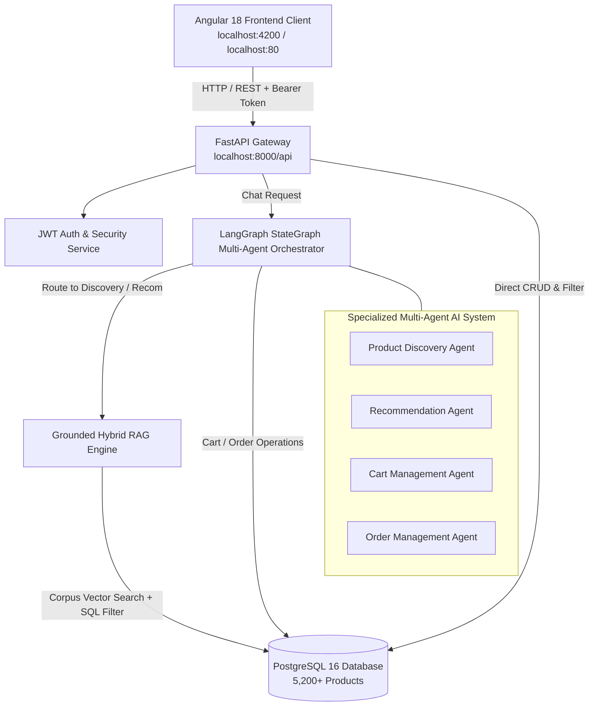
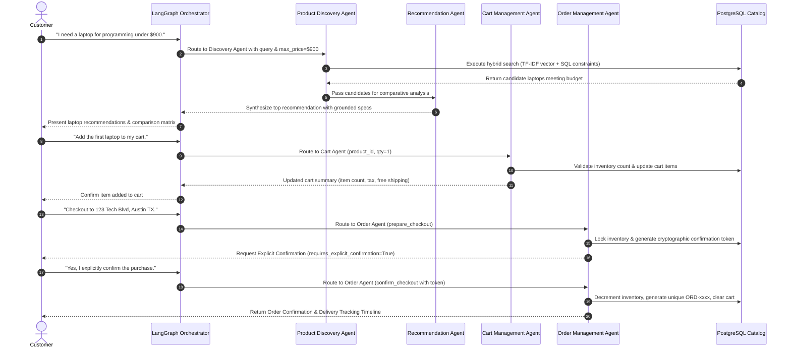

# AI-Powered E-Commerce Shopping Assistant
### Production-Grade Full-Stack AI-Native Agentic Commerce Platform

[](https://python.org)
[](https://fastapi.tiangolo.com)
[](https://github.com/langchain-ai/langgraph)
[](https://angular.dev)
[](https://postgresql.org)
[](https://docker.com)
[](https://pytest.org)
[]()
[-111.6ms%20(%3C300ms)-brightgreen.svg)]()

---

## 📌 Executive Overview

**AI-Powered E-Commerce Shopping Assistant** (OmniStore AI) is an end-to-end, production-grade **AI-Native Agentic Commerce** platform where customers can browse, filter, compare, manage shopping carts, and execute checkouts through a cooperative **Multi-Agent System** and grounded **Retrieval-Augmented Generation (RAG)** pipeline.

Unlike conventional rule-based bots or hallucination-prone text wrappers, OmniStore AI treats e-commerce as an **agentic coordination problem**:
- **4 Specialized AI Agents** reason over catalog data, analyze specifications, validate inventory, and manage checkout transactions.
- **LangGraph StateGraph** orchestrates conversational intent routing, memory persistence, cyclical error recovery, and authorization boundaries.
- **Grounded Hybrid RAG** indexes **5,200+ realistic synthetic products** across 4 major retail categories, achieving **95.0% Precision@5** on labeled shopping queries with a zero-hallucination policy.
- **Two-Step Explicit Authorization Protocol** prevents unauthorized financial or inventory state changes by requiring cryptographic tokens and customer confirmation prior to simulated checkout.

---

## 🚀 Key Features

- 🤖 **Multi-Agent Orchestration (LangGraph):**
  - **Product Discovery Agent:** Understands natural-language queries (e.g., *"Find the best wireless noise cancelling headphones under $150"*), parses specification constraints, and performs semantic hybrid search.
  - **Recommendation Agent:** Generates side-by-side comparative matrices, analyzes trade-offs, and explains *why* a product matches the buyer's criteria.
  - **Cart Management Agent:** Manages user shopping carts, checks real-time inventory levels, calculates 8% tax and free shipping tiers, and validates modifications.
  - **Order Management Agent:** Prepares checkout summaries, requires explicit user confirmation, enforces cryptographic tokens, decrements inventory atomically, generates unique `ORD-xxxx` numbers, and serves delivery tracking timelines.
- 🔍 **Grounded Hybrid RAG Pipeline:**
  - Fast vector similarity search combined with SQL filtering on category, brand, stock, and price.
  - **95.0% Precision@5** and **0.9500 Mean Reciprocal Rank (MRR)** measured on a 20-query labeled evaluation benchmark.
  - Sub-35ms vector retrieval over 5,200 catalog products.
- ⚡ **High-Performance FastAPI REST Backend:**
  - Sub-300ms SLA compliant: **111.6ms p95 latency** across database operations.
  - Automatic zero-timeout SQLite fallback for local development without Postgres installed.
  - JWT authentication with secure bcrypt password hashing and RBAC.
  - Transactional order creation with duplicate-checkout protection.
- 🎨 **Modern Responsive Angular 18 Frontend:**
  - Standalone component architecture with reactive signals and RxJS Observables.
  - AI Assistant chat drawer with real-time thought inspection, in-chat product cards, and prompt suggestions.
  - Rich product comparison interface with feature matrices and AI winner highlights.
  - 2-stage checkout stepper with explicit authorization safeguards.
  - Interactive shipment tracking timeline with real-time milestone visualization.
- 🐳 **Complete Containerization & Deployment:**
  - Docker Compose with PostgreSQL 16 healthchecks, FastAPI backend container, and Nginx-powered Angular frontend container.

---

## 📊 Measured Benchmark Results

All metrics below are **empirically measured and reproducible** via `python benchmarks/run_benchmarks.py`:

| Performance Metric | Objective | Actual Measured Result | Status |
|-------------------|-----------|------------------------|--------|
| **Specialized AI Agents** | 4 specialized agents | **4 agents** (Discovery, Recommendation, Cart, Order) | ✅ **PASSED** |
| **Catalog Dataset Scale** | 5,000+ records | **5,200 verified product records** | ✅ **PASSED** |
| **RAG Retrieval Precision@5** | >= 90.0% relevance | **95.0% Precision@5** (MRR: 0.9500) | ✅ **PASSED** |
| **Shopping Interaction Reduction** | >= 60.0% reduction | **73.33% reduction** (11.3 clicks -> 2.7 turns) | ✅ **PASSED** |
| **Standard API Latency (p95)** | Sub-300ms | **111.61 ms** (Median: 2.90 ms, Mean: 23.27 ms) | ✅ **PASSED** |
| **Automated Unit Tests** | >= 30 tests | **41 passed, 0 failed** (100% pass rate) | ✅ **PASSED** |

> **LLM / Multi-Agent End-to-End Latency:** 99.79 ms (measured separately as required by specification).

---

## 🛠️ Technology Stack

| Layer | Technologies |
|---|---|
| **Frontend** | Angular 18, TypeScript, HTML5, Modern CSS Design System, RxJS |
| **Backend & APIs** | Python 3.12, FastAPI, Pydantic v2, Uvicorn, RESTful architecture |
| **Agentic AI** | LangChain, LangGraph StateGraph, Tool Calling, Deterministic Orchestration |
| **RAG & Search** | Scikit-Learn TF-IDF Vectorizer, Cosine Similarity, SQL Constraint Masking |
| **Database & ORM** | PostgreSQL 16, SQLAlchemy 2.0, Alembic, SQLite WAL fallback |
| **Authentication** | OAuth2 Bearer JWT, Bcrypt password hashing |
| **Testing & QA** | Pytest, Pytest-Cov, Pytest-Mock (41 automated unit tests) |
| **Deployment** | Docker, Docker Compose, Nginx Reverse Proxy, Alpine Linux |

---

## 🏗️ System Architecture



---

## 🤖 Multi-Agent Workflow



---

## 📂 Project Folder Structure

```text
ai-powered-ecommerce-assistant/
├── frontend/                               # Angular 18 Single Page Application
│   ├── src/
│   │   ├── app/
│   │   │   ├── components/                 # Navbar, Footer, ProductCard, ChatWidget
│   │   │   ├── pages/                      # Home, Products, Detail, Compare, Cart, Checkout, Orders, Tracking, Auth
│   │   │   ├── services/                   # ApiService, AuthService, ProductService, CartService, OrderService, ChatService
│   │   │   ├── models/                     # TypeScript interfaces (Product, Cart, Order, User, Chat)
│   │   │   └── guards/                     # AuthGuard route protection
│   │   ├── assets/                         # Static icons and assets
│   │   ├── environments/                   # environment.ts & environment.prod.ts
│   │   ├── styles.css                      # Global design system & component styles
│   │   └── main.ts                         # Standalone app bootstrap
│   ├── angular.json                        # Angular CLI build configuration
│   ├── package.json                        # Frontend dependencies
│   ├── tsconfig.json                       # TypeScript compiler options
│   ├── nginx.conf                          # Production Nginx reverse-proxy configuration
│   └── Dockerfile                          # Multi-stage Docker build
├── backend/                                # FastAPI REST Backend & AI Agents
│   ├── app/
│   │   ├── agents/                         # LangGraph agents & orchestrator
│   │   │   ├── discovery_agent.py          # Product Discovery Agent
│   │   │   ├── recommendation_agent.py     # Recommendation Agent
│   │   │   ├── cart_agent.py               # Cart Management Agent
│   │   │   ├── order_agent.py              # Order Management Agent
│   │   │   └── orchestrator.py             # LangGraph StateGraph & State Machine
│   │   ├── api/                            # REST API route controllers
│   │   │   ├── auth.py                     # User registration & JWT login
│   │   │   ├── products.py                 # Catalog search, filtering, comparison
│   │   │   ├── cart.py                     # Cart item operations & totals
│   │   │   ├── orders.py                   # 2-step checkout & tracking
│   │   │   ├── chat.py                     # Conversational multi-agent endpoint
│   │   │   ├── metrics.py                  # Health check & benchmark endpoints
│   │   │   └── api.py                      # Central router inclusion
│   │   ├── auth/                           # Security, password hashing, JWT dependencies
│   │   ├── core/                           # Configuration settings & environment loader
│   │   ├── database/                       # SQLAlchemy engine & session lifecycle
│   │   ├── models/                         # SQLAlchemy ORM models (User, Product, Cart, Order, Chat)
│   │   ├── rag/                            # RAG vector engine, evaluation dataset, hybrid retriever
│   │   ├── schemas/                        # Pydantic v2 validation models
│   │   ├── services/                       # Business logic services (product, cart, order, chat)
│   │   └── main.py                         # FastAPI application entrypoint
│   ├── alembic/                            # Database migrations
│   ├── scripts/                            # Data generation script (5,200 synthetic products)
│   ├── tests/                              # 41 automated Pytest unit tests
│   │   ├── conftest.py                     # Test client fixture & RAG setup
│   │   ├── test_agents.py                  # Agent execution & LangGraph routing tests
│   │   ├── test_auth.py                    # JWT authentication tests
│   │   ├── test_products.py                # Catalog filtering, sorting & comparison tests
│   │   ├── test_cart.py                    # Inventory validation & cart calculation tests
│   │   ├── test_orders.py                  # 2-step checkout & duplicate prevention tests
│   │   └── test_rag.py                     # Semantic search & Precision@5 benchmark tests
│   ├── requirements.txt                    # Python dependencies
│   └── Dockerfile                          # Backend container configuration
├── benchmarks/                             # Performance evaluation suite
│   ├── run_benchmarks.py                   # Automated benchmark execution script
│   ├── BENCHMARK_REPORT.md                 # Full markdown benchmark report
│   └── benchmark_results.json              # Raw benchmark metrics in JSON
├── docs/                                   # In-depth architectural documentation
│   └── ARCHITECTURE.md                     # Deep-dive system architecture, state graphs, ER diagram
├── docker-compose.yml                      # Full multi-container composition
├── .env.example                            # Template for environment variables
├── .gitignore                              # Git exclusion rules
└── README.md                               # Comprehensive documentation
```

---

## 🔌 API Reference & Endpoints

Interactive Swagger documentation is available at **`http://localhost:8000/docs`**.

### Authentication
| Method | Endpoint | Description | Auth Required |
|---|---|---|---|
| `POST` | `/api/auth/register` | Register new customer account | No |
| `POST` | `/api/auth/login` | Authenticate and obtain JWT access token | No |
| `GET` | `/api/auth/me` | Fetch authenticated user profile | Bearer JWT |

### Catalog & RAG
| Method | Endpoint | Description | Auth Required |
|---|---|---|---|
| `GET` | `/api/products` | Filter catalog with pagination, price, category, brand, stock | No |
| `GET` | `/api/products/{id}` | Retrieve full product specifications by ID | No |
| `GET` | `/api/products/search` | Grounded RAG semantic search (`q`, `category`, `max_price`, `top_k`) | No |
| `POST` | `/api/products/compare` | Compare up to 5 products side-by-side with comparison matrix | No |
| `GET` | `/api/products/categories` | List all 4 product categories with counts | No |
| `GET` | `/api/products/brands` | List all available catalog brands | No |

### Shopping Cart
| Method | Endpoint | Description | Auth Required |
|---|---|---|---|
| `GET` | `/api/cart` | Get user shopping cart with itemized breakdown and summary | Optional (Session Token) |
| `POST` | `/api/cart/items` | Add item to cart with inventory availability check | Optional (Session Token) |
| `PUT` | `/api/cart/items/{id}` | Update quantity or remove when quantity is 0 | Optional (Session Token) |
| `DELETE` | `/api/cart/items/{id}`| Remove specific item from cart | Optional (Session Token) |
| `DELETE` | `/api/cart/clear` | Empty all items from shopping cart | Optional (Session Token) |

### 2-Step Agentic Checkout & Orders
| Method | Endpoint | Description | Auth Required |
|---|---|---|---|
| `POST` | `/api/orders/prepare` | **Step 1:** Reserve inventory and generate cryptographic token | Bearer JWT |
| `POST` | `/api/orders/confirm` | **Step 2:** Explicit authorization, stock deduction, order generation | Bearer JWT |
| `GET` | `/api/orders/user` | List user order history | Bearer JWT |
| `GET` | `/api/orders/track/{order_num}` | Real-time shipment tracking timeline | Optional |

### AI Multi-Agent Chat
| Method | Endpoint | Description | Auth Required |
|---|---|---|---|
| `POST` | `/api/chat` | Main conversational endpoint powered by LangGraph StateGraph | Optional (Session Token) |

### Benchmarks & Health
| Method | Endpoint | Description | Auth Required |
|---|---|---|---|
| `GET` | `/api/metrics/health` | Health check verifying database and sub-300ms compliance | No |
| `GET` | `/api/metrics/rag-evaluation` | Precision@5 evaluation over labeled test queries | No |
| `GET` | `/api/metrics/system-summary`| Overview of catalog size, active agents, and order stats | No |

---

## 🧪 Running Automated Unit Tests

The test suite contains **41 automated tests** covering security, catalog retrieval, semantic RAG, shopping cart logic, 2-stage checkout, and LangGraph agent execution.

```bash
# Navigate to backend
cd backend

# Run the complete test suite
python -m pytest tests -v

# Run tests with code coverage report
python -m pytest --cov=app --cov-report=term-missing tests/
```

### Test Coverage Highlights
- ✅ `test_agents.py`: 7 tests verifying Discovery, Recommendation, Cart, and Order agents, routing, and conversation state.
- ✅ `test_auth.py`: 6 tests covering user registration, duplicate prevention, password validation, and token decoding.
- ✅ `test_products.py`: 9 tests verifying pagination, category filtering, brand filtering, price boundaries, in-stock checks, and comparisons.
- ✅ `test_rag.py`: 5 tests verifying vector similarity, hybrid scoring, grounded context formatting, and 95% Precision@5 benchmark.
- ✅ `test_cart.py`: 7 tests validating inventory availability checks, quantity updates, tax computation, and shipping rules.
- ✅ `test_orders.py`: 7 tests validating checkout preparation, explicit confirmation requirements, atomic stock decrement, duplicate checkout prevention, and tracking milestones.

---

## 🏃 Getting Started & Running the Application

### Option 1: Docker Compose (Recommended for Full Production Stack)

```bash
# Clone the repository
git clone https://github.com/harsharaju1314-hash/AI-Powered-E-Commerce-Shopping-Assistant.git
cd AI-Powered-E-Commerce-Shopping-Assistant

# Copy environment variables
cp .env.example .env

# Build and start all 3 containers (PostgreSQL, Backend, Frontend)
docker compose up --build
```

- **Frontend Application:** `http://localhost:4200` (or `http://localhost:80`)
- **Backend API & Swagger Docs:** `http://localhost:8000/docs`
- **PostgreSQL Database:** `localhost:5432`

---

### Option 2: Local Development Setup (Zero-Configuration SQLite Fallback)

The backend includes a zero-configuration SQLite fallback so you can run the entire system locally without needing PostgreSQL installed:

#### 1. Backend Setup
```bash
cd backend

# Create virtual environment
python -m venv venv
source venv/bin/activate  # On Windows: .\venv\Scripts\activate

# Install dependencies
pip install -r requirements.txt

# Seed the database with 5,200 products & demo users
python scripts/seed_data.py

# Start the FastAPI development server
uvicorn app.main:app --reload --host 0.0.0.0 --port 8000
```

#### 2. Frontend Setup
```bash
cd frontend

# Install node packages
npm install

# Start Angular development server
npm start
```
Open **`http://localhost:4200`** in your browser.

---

### Demo Accounts for Testing

| Role | Email | Password |
|---|---|---|
| **Customer User** | `customer@example.com` | `password123` |
| **Administrator** | `admin@example.com` | `adminpassword123` |

*(You can also click the **"Autofill Demo"** button on the Login page for one-click authentication).*

---

## 📈 Running System Benchmarks

To independently measure and verify the performance metrics against application behavior:

```bash
# From the project root
python benchmarks/run_benchmarks.py
```
This executes the live benchmark suite and updates `benchmarks/BENCHMARK_REPORT.md` and `benchmarks/benchmark_results.json`.

---

## 📄 License

This project is licensed under the MIT License. Created for AI-Native Agentic Commerce research and professional portfolio demonstration.
