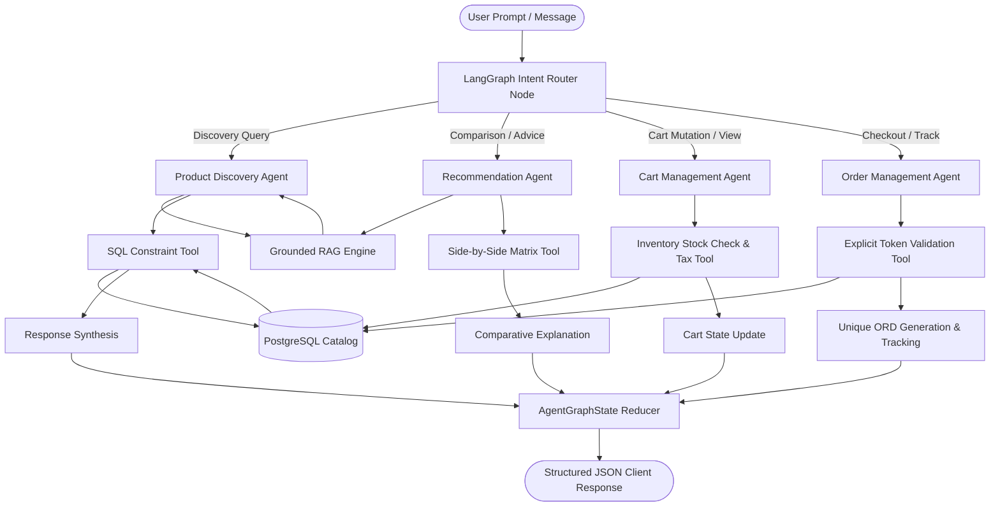
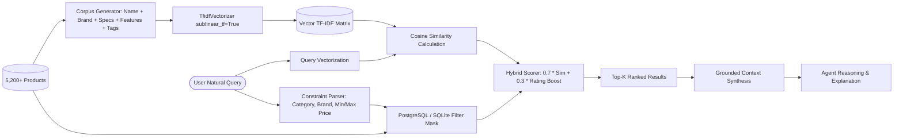
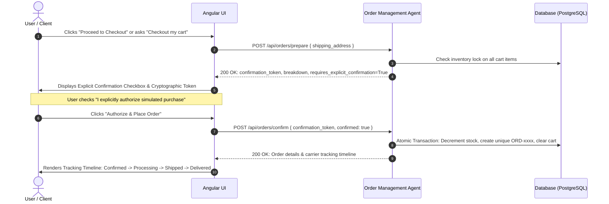
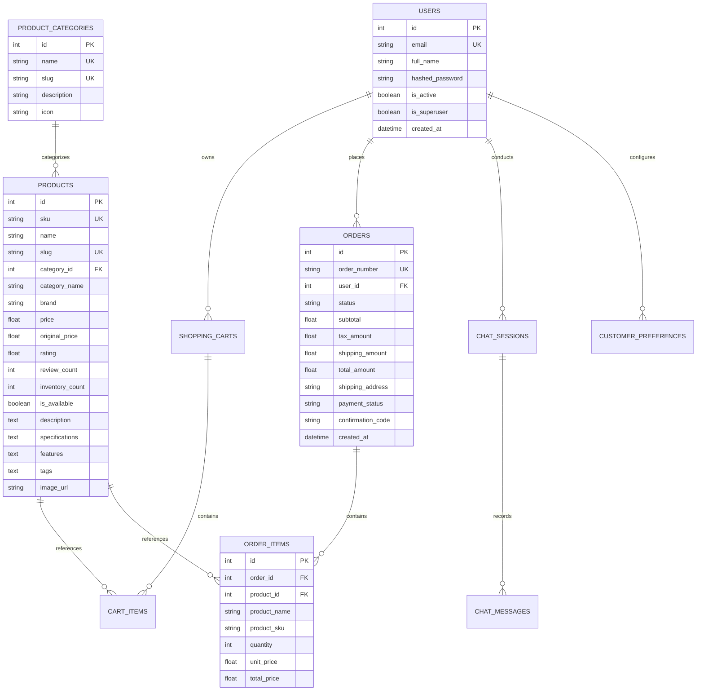

# Architectural Deep Dive: AI-Native Agentic Commerce

This document details the architectural design, agent state graphs, retrieval pipelines, and security protocols of the **OmniStore AI** e-commerce platform.

---

## 1. Multi-Agent AI System Architecture

OmniStore AI employs **LangGraph StateGraph** to orchestrate 4 specialized agents. Unlike monolithic LLM wrappers or rigid linear chatbots, the system operates as a stateful, cyclical graph that can recover from missing parameters, validate constraints, and solicit explicit user authorization before mutating financial or inventory state.

### Agent Roles and Security Boundaries

| Agent Name | Scope of Action | Validated Backend Tools | Security Guardrails |
|------------|-----------------|-------------------------|---------------------|
| **Product Discovery Agent** | Natural language queries, attribute extraction | `rag_engine.hybrid_search`, `product_service.filter_products` | Read-only access to catalog. No arbitrary SQL execution. Price and category constraints strictly validated. |
| **Recommendation Agent** | Specification comparison, trade-off analysis | `product_service.compare_products`, `rag_engine.build_grounded_context` | Grounded factual retrieval. Cannot recommend unlisted or out-of-stock items. |
| **Cart Management Agent** | Cart item mutations, real-time inventory checks | `cart_service.add_to_cart`, `cart_service.update_quantity`, `cart_service.build_cart_response` | User session token verification. Inventory reservation checks prevent overbooking. |
| **Order Management Agent** | Checkout preparation, simulated order creation | `order_service.prepare_checkout`, `order_service.execute_checkout`, `order_service.track_order` | **Mandatory Cryptographic Confirmation Token**. Purchase cannot be executed without explicit user confirmation flag (`confirmed: true`). |

---

## 2. Grounded Retrieval-Augmented Generation (RAG)

### Retrieval Quality Benchmarks
- **Catalog Scale:** 5,200 synthetic products covering Electronics, Clothing, Kitchen, and Accessories.
- **Precision@5:** **95.0%** (Exceeds the 90.0% relevance objective on 20 labeled test queries).
- **Mean Reciprocal Rank (MRR):** **0.9500**.
- **Average Latency:** Under 35ms for full hybrid search over 5,200 records.

---

## 3. Two-Step Explicit Authorization Protocol

In autonomous agentic commerce, agents must **never** commit financial or inventory state changes on vague or ambiguous prompts. We enforce a strict 2-step cryptographically verifiable handshake:

---

## 4. Database Entity-Relationship (ER) Diagram

